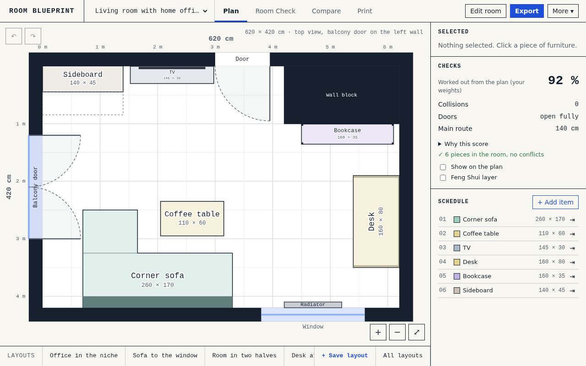
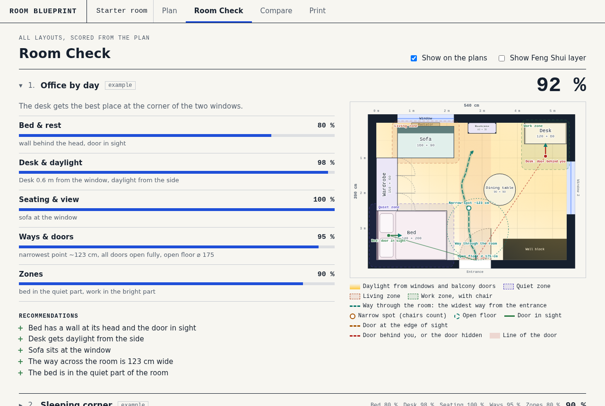
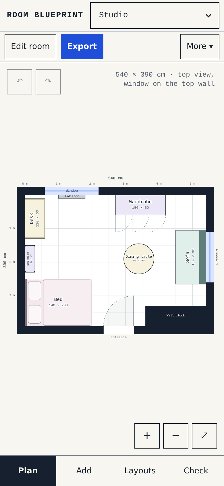

# Room Blueprint

Plan a room in 2D and try out furniture layouts, right in your browser. Draw the room with its doors, windows and
fixtures, place furniture, and let Room Check compare your layouts on ways, light, doors and zones.

There is nothing to install and no account. It has no dependencies and no build step: open `index.html` in a browser,
with `css/`, `js/` and `demo/` next to it.

**Try it:** [leostumpf.github.io/RoomBlueprint](https://leostumpf.github.io/RoomBlueprint/)



| Room Check | On a phone |
| --- | --- |
|  |  |

The screenshots show demo rooms that come with the tool.

## Features

- Rooms of any size with any number of doors, windows and balcony doors, plus radiators, niches, columns and wall blocks
- A furniture catalog with generic sizes, round and L-shaped pieces, groups and your own templates
- Layouts you can save, compare side by side and move between projects
- Room Check: a neutral, calculated review of every layout, with reasons and suggestions
- An optional Feng Shui layer that reads the same findings in its own terms
- Scale drawings for printing, with dimension chains and a parts list
- Project files you can export, import and keep
- Dark mode, keyboard control and phone layouts

## Privacy

**Everything stays in your browser.** Room Blueprint has no account, no analytics and no cookies, and the pages load
nothing from other sites. Your rooms are not sent anywhere.

- Projects are kept in this browser's `localStorage`. They do not reach other browsers or devices, and opening the tool
  from disk and through a server counts as two separate stores.
- Clearing your browser data deletes your projects, so use **Export** to keep a copy.
- A site hosting the tool sees an ordinary page request, as any website does, but never your rooms.
- `serve.py` is optional and runs on your own computer. Only then are projects stored outside the browser, in a file on
  that computer. See [Sharing between your devices](#sharing-between-your-devices).

## How to use

- Drag furniture from the parking area, to the right of the room, into the room.
- Double click or `R` turns a piece by 90°, `Q`/`E` by ±15°. Drag the round handle to turn it freely.
- Arrow keys move it by 1 cm (`Shift`: 10 cm). `Shift` while dragging turns snapping off.
- `D` duplicates, `Del` sets aside, `Ctrl+Z`/`Ctrl+Y` undo and redo, `Esc` deselects.
- The selected piece shows its free distances to the walls and to the nearest furniture.
- A cross and a solid red frame mean a piece runs into a wall, a fixture or other furniture. An exclamation mark and a
  dashed orange frame mean it stands in the swing of a door, or that its own doors cannot open.
- **Edit room** opens the room editor. A new project starts with an assistant: pick a room from the library, create an
  empty room or import a file. **Clear room** at the bottom left of the plan moves all furniture to the parking area, for a
  start from zero; Undo brings it back.
- Every key has a button: "Selected" in the inspector, with ±15° and the arrows under "More options", and Undo and Redo on
  the canvas. The "Schedule" list selects a piece without the mouse. Layouts sit in the bar below the plan. Project actions,
  import, PNG, printing and the help are under "More". On a phone, Selected, Checks and Schedule are a separate sheet (tab
  "Check"), with buttons below the plan.

## Furniture

"Add furniture" opens the catalog: about 150 pieces in groups for the living room, TV, bedroom, storage, kitchen and dining,
home office, kids room, bathroom, hallway and balcony, with common sizes and no brands (`js/catalog.js`). Your own templates
come first. New furniture lands in the parking area.

- **Search** knows other words ("couch" finds sofas, "telly" the TVs, "closet" the wardrobes) and sizes in cm: "sofa 200"
  puts the sofas closest to 200 cm wide first, "200x90" or "200 x 90 cm" the pieces closest to that size, and each one says
  how far it is off.
- **Your own piece**: name, width, depth, height if it matters, shape and type in one step. ✎ next to a piece of the catalog
  or a template starts from it, so you only change the sizes. "Make your own" below a search starts from the closest match
  with the size you searched for. "Also keep as a template" puts it into your templates.

- **Type** decides which checks apply, and "More options" in the inspector names them. Changing it removes what the old type
  needed. A dining table is `Other`, because the type `Desk` means a workplace with a chair and light.
- **Height**: left empty, the usual height of the type applies. It decides whether a piece blocks the picture, the TV or the
  view of a door.
- **Options**: doors and mirror for a wardrobe, a projector with its picture width for a media board (off unless you switch it on), "Free in front" for everything.
  Left empty, a wardrobe uses its door width. Use 0 for sliding doors.
- **Shapes**: rectangle, round or oval (table, other), L shape (sofa, other) with leg width, back depth and side. An L shape is
  one piece, and its open corner stays free for all checks.
- **Templates**: "Save as template" keeps a piece in this browser, for the catalog of every project. Templates are not part
  of a project: they are not in the project file and are not shared.
- **Groups**: "Group with…" or `Ctrl`+click joins pieces. A group is dragged, moved with the arrow keys and set aside
  together. Turning and duplicating still apply to a single piece.
- **Set aside** moves a piece to the parking area, where it is not checked. **Delete** removes it from the project and from
  all layouts. A layout file can still mark pieces as `hidden`: they are not drawn, the list shows them as `parked`, and a
  click brings them to the parking area.

## Projects

A project is a room with its furniture and layouts. You can switch, create, rename and delete projects in the planner. The
start assistant appears for a new project and on the first visit in a browser without data of its own. It offers a small
room library from `demo/rooms.js` in five groups (Living room, Bedroom, Kids room, Home office, One-room flat): eleven rooms,
some of them odd, such as long and narrow, an L from a bathroom block, an alcove, a chimney, a corner column or two doors.
Each has generic furniture, two to four example layouts with a short idea, and a TV rather than a projector. A new project
opens on the first layout, already furnished. "Move" takes a layout to another project: missing furniture comes along, notes
only into an equal room.

## Room editor

"Edit room" on the canvas fades the furniture and shows round handles:

- Drag any of the four walls or the bottom right corner to change width and length, and the handle outside the bottom left
  corner for the wall thickness, or type the values (they move the right and bottom walls). Whatever stands at the wall you
  drag moves along with it. Moving the left or top wall leaves everything else on its spot of the floor, in the saved layouts
  too. The room cannot get smaller than its openings and fixtures, and a message says why.
- Drag doors and windows along a wall and onto other walls. The panel sets the name, type, hinge, direction (into the room or
  outwards) and the main entrance.
- Add radiators, niches, columns and wall blocks, then drag, resize and turn them.
- Rooms stay a rectangle, and fixtures give them their shape. "Cut a corner" puts a wall block into the corner you pick, for
  an L or a cut corner, and its handle at the inner corner resizes it. "U shape" puts one in the middle of a wall. The checks
  treat chimneys, niches, columns and wall blocks as walls: a bed can rest its head against them, a chair cannot stand in
  them, a column or wall block hides the door, and a projected picture has to stay on the block it falls on.
- The "In the room" list in the panel shows all openings and fixtures. It also selects them without the mouse, and the arrow
  keys, `Del` and `Esc` then work from the list.
- Undo and redo cover room and furniture together. If furniture ends up outside, the checks say so, with the number of
  layouts affected. Furniture in the parking area stays outside when the room grows.

## Printing a plan

"Print plan / PDF" (or `Ctrl+P`) prints the current arrangement as a technical drawing: A4 portrait, black on white, in the
largest standard scale that fits (from 1:20, named on the plan), with a scale bar, dimension chains, free distances, a parts list
with wall distances and a title block. Collisions are listed under "Measure again". Choose 100 % in the print dialog, or only the
scale bar stays correct. Checks on the plan, the Feng Shui layer, the selection and the parking area are not printed.

## Room Check

`room-check.html` (tab "Room Check") shows all layouts of the open project, and before them the current arrangement if it is
not saved. Each review is worked out from the plan when the page opens (`reviewLayout()` in `js/recommend.js`), so it always
fits the current room: five criteria, what speaks for the layout, what speaks against it and what could change. The texts come
from the rules in `RULES` and `CHECK_RULES`, triggered by what the checks find. If furniture overlaps or stands in a wall, the
layout cannot be built this way, and the total stays at 40 % or below. Every criterion and the total are shown in percent: here, in
Compare, in the print view and in the planner. Inside, a criterion is rated from 1 to 5 (5 is 100 %). The percentages use the
values before rounding, which take off a little where the way, the free space or the distance to the window still has room to
spare, so they separate good layouts too. The plans come from the same renderer as the planner, for viewing only.

The **room profile** (Balanced, Home office, Sleeping, Living, Studio) sets the weights. Your own changes to the weights stay in
the project, and "Standard" goes back to the profile.

**Room Check** is neutral and always on. The inspector in the planner shows the same review as the tab: the total, collisions,
doors and the main way, and under "Why this score" the five criteria as percentage bars with a short reason, plus the most
important suggestions. After a change it updates after a short pause, or at once with the checks shown on the plan.

**Show on the plan** draws what the checks find: zones, daylight, the widest way from the entrance to the balcony door or the
window (a grid path in which chairs count as obstacles) with its narrowest spot, the free space, the view of the doors from beds
and desks, and the line of each door. The view rates the main entrance (without a marked one, the first door), while the
door line applies to every door.

The **Feng Shui layer** is a separate switch, applies to all pages and is off by default. It names the same findings in its own
terms (chi, yin and yang, commanding position) and adds its own reading (`fengShuiReading()` in `js/recommend.js`). It never changes
a score.

## Compare and print view

`compare.html` (tab "Compare") shows up to four layouts of the project side by side in the order you pick, including your own
and the unsaved current arrangement. The pick is stored in the browser; without one you see the best four. `compare.html?print`
(tab "Print") shows the same pick as A4 landscape sheets: first the plans with their scores, then pros and cons with a notes field.
Long texts run on to further pages, and nothing is cut. Printing from either tab gives this layout.

## Sharing between your devices

```
python3 serve.py                          # this computer only, http://127.0.0.1:8080
python3 serve.py 8080 --host 0.0.0.0      # reachable from the whole network
python3 serve.py --data ~/room-data       # projects in another folder
```

**`serve.py` has no login and no encryption.** Anyone who can reach the server can read, change and delete all projects. That is
why it listens on `127.0.0.1` by default. Use `--host 0.0.0.0` only in a home network you trust, never on the internet or on
networks you do not control.

`serve.py` serves only the planner's files (`PAGES`; add new files there) and marks its pages with a `<meta>` tag, so a page
recognises it and does not even ask on static hosts. It keeps projects in `data/projects.json` (gitignored; choose the folder with
`--data`), so that all devices see the same ones. The untouched starter room stays local. `data/variants.json` from the first
version is no longer served and stays untouched on disk.

How devices stay in step:

- Before writing, a device fetches the server's state and merges it with its own. The server refuses a `PUT` that is not based on
  the latest state (`If-Match`), and the device then starts over.
- Deletions are recorded as notes: a layout or project stays gone even if another device still has an older copy. If it was edited
  elsewhere after the deletion, the later change wins. The order comes from the devices' clocks.
- Where copies differ, the newer one decides room, furniture and weights per project, and layouts are merged by name.

Restart the server after changing `serve.py`.

## Project file

A project file (`app: "room-blueprint"`, `version: 2`) contains:

- `room`: `w`, `l`, `wall`, `openings[]` and `fixtures[]` (`type`, `x`, `y`, `w`, `d`). An opening has `type` (`door`, `balcony`,
  `window`), `wall` (`top`, `right`, `bottom`, `left`), `pos` and `width`. Then comes `hinge`: `start` and `end` are the hinge side at
  the start of the wall (left or top) or at its end, `both` means two leaves. Windows do not swing and need no `hinge`. Openings
  may not overlap. `main: true` marks the main entrance (not on windows, once at most); otherwise the first door counts.
  `swing: "out"` opens outwards and takes no space in the room, and `name` replaces the generated name. The planner lets you pick
  the main entrance as soon as there is a choice, also for a balcony door as the only door. The way through the room runs from
  the main entrance to the first balcony door. Without one it ends at the nearest well accessible spot at the widest window, not
  in a gap behind furniture. A balcony door must be freely reachable, while furniture may stand in front of a window.
- `furniture[]`: the pieces of a project with `id`, `name`, `kind`, `w`, `d`, `color`, and optionally `h`, `doors`, `mirror`,
  `image`, `beamer`, `clear` (free space in front), `shape` (`round`, `L`), `leg` (`[leg width, back depth]`), `flip` and `group`
- `layouts[]`: `name`, `place` (furniture id → `[x, y, rotation]`), and optionally `hidden`, `savedAt`, `idea` and `review` (notes
  from older files: `pro`, `con`, `tip`, `now`). Scores are not in the file, they are calculated from the plan. A `score` in an older
  file is dropped on reading, and notes appear apart from the calculation
- `current`: the current arrangement. `weights`: the weights of the analysis (keys `bed`, `desk`, `sofa`, `flow`, `zones`; older keys
  are renamed on reading). `profile`: the room profile. `baseWeights`: the weights the file came with. "Standard" goes back to the
  profile, otherwise to `baseWeights`, otherwise to neutral
- `deletedLayouts`: notes about deleted layouts for syncing between devices. Only in the browser and on the server, not in exported
  files

A layout stores only the arrangement, sizes belong to the project. An import always creates a new project and checks the whole
file: if anything is invalid, nothing changes. Exports of the older version 1 can still be imported. A browser that still holds data
of that version carries it over on first start. Because that data has no room, it stays in the starter room until a v1 file with
a room is imported, which then takes it in. If that project has been edited in the meantime, it stays, and the file is imported as a
project of its own, with a notice.

### Optional local project folder

Projects you want at hand on your own computer, without putting them in the repository, can go into an optional local
project folder: `local/` next to `index.html`, gitignored, also as a link to a folder elsewhere. Write a project file into it with

```
node tools/local-project.js my-project.json --id local-my-room --name "My room"
```

That writes `local/projects.js`, a classic script, so it also loads under `file://`. The planner asks for it only when it runs
from disk or on `localhost`/`127.0.0.1`, never on any other host, and `serve.py` hands it only to this computer. Each project in
it joins a browser once, under its fixed id, and opens. After that the browser keeps your work: the file never overwrites a
project, and one you deleted does not come back. **More → Restore local project** adds the saved state again as a new project.

## Development

Classic `<script>` files without modules, so that everything also runs under `file://`:

- `js/platform.js`: the only place for browser specifics (storage, files, printing, server)
- `js/geometry.js`, `js/analyze.js`: pure logic with no DOM and no global state
- `js/project.js`: project format, validation, v1 import (pure); `js/workspace.js`: the projects in the browser
- `js/dialogs.js`: custom dialogs instead of `alert`, `confirm` and `prompt`
- `js/recommend.js`: reviewing a layout and the rule-based suggestions (pure)
- `js/room-edit.js`: changes to the room (pure); `js/room-editor.js`, `js/start.js`: editor and assistant
- `js/catalog.js`, `js/item-edit.js`: catalog and changes to furniture (pure); `js/furniture-panel.js`: inspector
- `js/render.js`, `js/print.js`: drawing, with room and furniture passed in as parameters
- `js/app.js`, `js/analysis-page.js`, `js/compare-page.js`: one per page
- `demo/`: data as `.js`, because `fetch` does not work under `file://`
- `tools/local-project.js`: writes the optional local project folder (see above)
- `css/app.css`: shared, plus one file per page. It holds the Blueprint tokens for light and dark, including those of the plan
  (`--plan-*`), because `js/render.js` sets no fixed colours. Paper is always light. Fonts: IBM Plex if it is on the device, otherwise
  system fonts. Nothing is loaded from the network

Tests: `node --test`. Type check (`// @ts-check` and `jsconfig.json`): `tsc -p jsconfig.json`. See
[CONTRIBUTING.md](CONTRIBUTING.md).

## License

[MIT](LICENSE)
